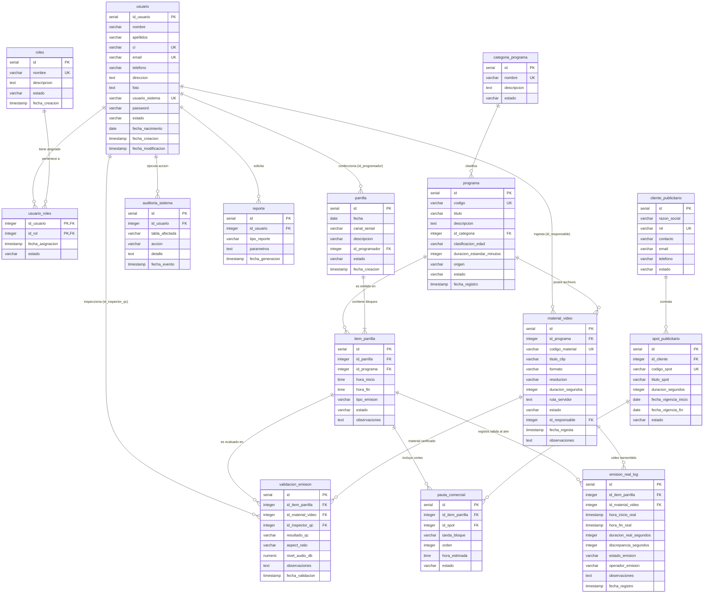

# 📡 BASE DE DATOS: SISTEMA DE GESTIÓN DE PARRILLA DE TELEVISIÓN
## Playout Automation & Broadcast Management System (BMS)
**Institución:** Universidad Autónoma Gabriel René Moreno (UAGRM)  
**Facultad:** Facultad Integral del Norte / FICCT - Sistemas de Información II  
**Grupo:** 12 SC | **Motor:** PostgreSQL 12+  
**Servidor de Base de Datos:** `mail.tecnoweb.org.bo:5432`  
**Base de Datos:** `db_grupo12sc` | **Usuario:** `grupo12sc`  

---

## 📑 1. DESCRIPCIÓN GENERAL Y ARQUITECTURA DE DATOS

El esquema de base de datos da soporte a la operación ininterrumpida de una estación televisiva moderna (24/7). Permite la gestión de usuarios y roles técnicos, la clasificación y parametrización del catálogo de programas, la confección de la grilla de emisión diaria (Parrilla/Playlist), el control de activos audiovisuales (MAM - Material Video), la validación de calidad técnica previa al aire (Quality Control - QC), la inserción de pautas y cortes comerciales, la conciliación de transmisión real (*As-Run Log*) y la generación de estadísticas y reportes gerenciales.

### 🎯 Distribución por Casos de Uso (CU1 - CU8)

| Caso de Uso | Módulo / Función Operativa | Tablas Involucradas | Descripción Funcional |
| :--- | :--- | :--- | :--- |
| **CU1** | **Gestión de Usuarios y Roles** | `usuario`, `roles`, `usuario_roles` | Operadores del sistema, credenciales, datos personales y perfiles (Administrador, Programador, Encargado de Contenidos). |
| **CU2** | **Catálogo de Programas y Categorías** | `categoria_programa`, `programa` | Fichas técnicas de contenidos, origen, código único, clasificación por edades y duración estándar. |
| **CU3** | **Confeccionar y Controlar Parrilla** | `parrilla`, `item_parrilla` | Grilla de programación por fecha/señal y bloques horarios detallados (rundown / escaleta diaria). |
| **CU4** | **Gestión de Materiales de Video (MAM)** | `material_video` | Activos de video transcodificados, código MAM, resolución, duración exacta en segundos y storage. |
| **CU5** | **Validar Estado de Emisión (Control QC)** | `validacion_emision` | Control de calidad técnico de audio (EBU R128) y video antes de habilitar la salida al aire. |
| **CU6** | **Pauta Publicitaria y Spots Comerciales** | `cliente_publicitario`, `spot_publicitario`, `pauta_comercial` | Catálogo de anunciantes, contratos de spots y asignación en tandas/cortes comerciales. |
| **CU7** | **Conciliar Emisión Real y Auditoría** | `emision_real_log`, `auditoria_sistema` | Bitácora de transmisión efectiva (*As-Run Log*), cálculo de discrepancias en segundos y auditoría de eventos. |
| **CU8** | **Reportes Estadísticos y Métricas** | `reporte` | Registro y parametrización de reportes ejecutivos de playout y facturación publicitaria. |

---

## 🗺️ 2. DIAGRAMA ENTIDAD - RELACIÓN (MERMAID)



---

## 📚 3. DICCIONARIO DE DATOS DETALLADO

### 3.1. CU1: Gestión de Usuarios y Roles

#### Tabla: `usuario`
Almacena los operadores del canal, credenciales de acceso para consola/correo y perfil personal.

| Campo | Tipo SQL | Nulo | Clave / Restricción | Descripción |
| :--- | :--- | :---: | :---: | :--- |
| `id_usuario` | SERIAL | NO | PK | Identificador único secuencial del usuario. |
| `nombre` | VARCHAR(100) | NO | - | Nombres de pila del operador. |
| `apellidos` | VARCHAR(100) | NO | - | Apellidos completos del operador. |
| `ci` | VARCHAR(30) | NO | UNIQUE | Cédula de Identidad o documento oficial. |
| `email` | VARCHAR(150) | NO | UNIQUE | Correo electrónico corporativo o personal para comandos. |
| `telefono` | VARCHAR(30) | SÍ | - | Teléfono o celular de contacto institucional. |
| `direccion` | TEXT | SÍ | - | Domicilio registrado del operador. |
| `foto` | TEXT | SÍ | - | Ruta local o avatar del perfil de usuario. |
| `usuario_sistema` | VARCHAR(100) | SÍ | UNIQUE | Nombre de usuario simplificado para login alternativo. |
| `password` | VARCHAR(255) | NO | - | Contraseña de acceso en texto/hash seguro. |
| `estado` | VARCHAR(30) | NO | DEFAULT 'ACTIVO' | Estado: `'ACTIVO'`, `'INACTIVO'`, `'BLOQUEADO'`. |
| `fecha_nacimiento`| DATE | SÍ | - | Fecha de nacimiento para el legajo de personal. |
| `fecha_creacion` | TIMESTAMP | NO | DEFAULT CURRENT_TIMESTAMP | Fecha y hora de alta del usuario en el sistema. |
| `fecha_modificacion`| TIMESTAMP | NO | DEFAULT CURRENT_TIMESTAMP | Fecha y hora de la última modificación de datos. |

#### Tabla: `roles`
Catálogo de perfiles funcionales para control de acceso basado en roles (RBAC).

| Campo | Tipo SQL | Nulo | Clave / Restricción | Descripción |
| :--- | :--- | :---: | :---: | :--- |
| `id` | SERIAL | NO | PK | Identificador único del rol. |
| `nombre` | VARCHAR(50) | NO | UNIQUE | Nombre (`ADMINISTRADOR`, `PROGRAMADOR`, `ENCARGADO_CONTENIDOS`). |
| `descripcion` | TEXT | SÍ | - | Alcance y atribuciones operativas del rol. |
| `estado` | VARCHAR(30) | NO | DEFAULT 'ACTIVO' | Estado del rol: `'ACTIVO'`, `'INACTIVO'`. |
| `fecha_creacion` | TIMESTAMP | NO | DEFAULT CURRENT_TIMESTAMP | Fecha de creación del perfil. |

#### Tabla: `usuario_roles`
Tabla intermedia muchos a muchos que asocia usuarios con uno o múltiples roles.

| Campo | Tipo SQL | Nulo | Clave / Restricción | Descripción |
| :--- | :--- | :---: | :---: | :--- |
| `id_usuario` | INTEGER | NO | PK, FK -> `usuario(id_usuario)` ON DELETE CASCADE | Código del usuario vinculado. |
| `id_rol` | INTEGER | NO | PK, FK -> `roles(id)` ON DELETE CASCADE | Código del rol otorgado. |
| `fecha_asignacion` | TIMESTAMP | NO | DEFAULT CURRENT_TIMESTAMP | Momento exacto de concesión del rol. |
| `estado` | VARCHAR(30) | NO | DEFAULT 'ACTIVO' | Estado de la asignación: `'ACTIVO'`, `'INACTIVO'`. |

---

### 3.2. CU2: Catálogo de Programas y Categorías

#### Tabla: `categoria_programa`
Categorías temáticas y géneros televisivos para la grilla de emisión.

| Campo | Tipo SQL | Nulo | Clave / Restricción | Descripción |
| :--- | :--- | :---: | :---: | :--- |
| `id` | SERIAL | NO | PK | Identificador numérico de la categoría. |
| `nombre` | VARCHAR(100) | NO | UNIQUE | Nombre (`NOTICIAS`, `DEPORTES`, `TELENOVELA`, `ENTRETENIMIENTO`, etc.). |
| `descripcion` | TEXT | SÍ | - | Descripción temático-editorial del género televisivo. |
| `estado` | VARCHAR(30) | NO | DEFAULT 'ACTIVO' | Estado: `'ACTIVO'`, `'INACTIVO'`. |

#### Tabla: `programa`
Ficha técnica del contenido o serie que conforma el inventario de emisión.

| Campo | Tipo SQL | Nulo | Clave / Restricción | Descripción |
| :--- | :--- | :---: | :---: | :--- |
| `id` | SERIAL | NO | PK | Identificador correlativo del programa. |
| `codigo` | VARCHAR(30) | NO | UNIQUE | Código mnemotécnico institucional (ej: `NOT-001`, `DEP-001`). |
| `titulo` | VARCHAR(150) | NO | - | Título oficial del programa televisivo. |
| `descripcion` | TEXT | SÍ | - | Sinopsis o descripción del formato del programa. |
| `id_categoria` | INTEGER | NO | FK -> `categoria_programa(id)` | Categoría temática asociada. |
| `clasificacion_edad`| VARCHAR(20)| NO | DEFAULT 'ATP' | Restricción: `'ATP'`, `'TEEN_14'`, `'ADULTO_18'`. |
| `duracion_estandar_minutos`| INTEGER| NO | DEFAULT 60 | Duración nominal típica de transmisión en minutos. |
| `origen` | VARCHAR(50) | NO | DEFAULT 'NACIONAL' | Procedencia: `'NACIONAL'`, `'INTERNACIONAL'`, `'COPRODUCCION'`. |
| `estado` | VARCHAR(30) | NO | DEFAULT 'ACTIVO' | Estado en catálogo: `'ACTIVO'`, `'INACTIVO'`, `'ARCHIVADO'`. |
| `fecha_registro`| TIMESTAMP | NO | DEFAULT CURRENT_TIMESTAMP | Fecha y hora de alta en la biblioteca de contenidos. |

---

### 3.3. CU3: Confección y Control de la Parrilla de Programación

#### Tabla: `parrilla`
Encabezado de la programación estructurada por fecha y señal de transmisión.

| Campo | Tipo SQL | Nulo | Clave / Restricción | Descripción |
| :--- | :--- | :---: | :---: | :--- |
| `id` | SERIAL | NO | PK | Identificador de la parrilla diaria. |
| `fecha` | DATE | NO | - | Fecha del calendario a la que corresponde la grilla. |
| `canal_senial` | VARCHAR(50) | NO | DEFAULT 'SENIAL_PRINCIPAL_HD' | Identificador de señal (`SENIAL_PRINCIPAL_HD`, `SENIAL_2`). |
| `descripcion` | VARCHAR(200)| SÍ | - | Nota u observaciones del día de transmisión. |
| `id_programador`| INTEGER | NO | FK -> `usuario(id_usuario)` | Programador responsable de confeccionar la parrilla. |
| `estado` | VARCHAR(30) | NO | DEFAULT 'BORRADOR' | Ciclo: `'BORRADOR'`, `'APROBADA'`, `'PUBLICADA'`, `'CERRADA'`. |
| `fecha_creacion`| TIMESTAMP | NO | DEFAULT CURRENT_TIMESTAMP | Momento de creación de la grilla en el sistema. |

#### Tabla: `item_parrilla`
Rundown / Escaleta: Cada bloque u orden de emisión programado dentro de una parrilla horaria.

| Campo | Tipo SQL | Nulo | Clave / Restricción | Descripción |
| :--- | :--- | :---: | :---: | :--- |
| `id` | SERIAL | NO | PK | Identificador único del bloque de emisión. |
| `id_parrilla` | INTEGER | NO | FK -> `parrilla(id)` ON DELETE CASCADE | Grilla a la que pertenece el bloque. |
| `id_programa` | INTEGER | NO | FK -> `programa(id)` | Contenido televisivo programado. |
| `hora_inicio` | TIME | NO | - | Hora estimada de inicio (formato 24h `HH:mm:ss`). |
| `hora_fin` | TIME | NO | - | Hora estimada de fin (formato 24h `HH:mm:ss`). |
| `tipo_emision` | VARCHAR(30) | NO | DEFAULT 'GRABADO' | Tipo: `'VIVO'`, `'GRABADO'`, `'REPETICION'`, `'CADENA_OFICIAL'`. |
| `estado` | VARCHAR(30) | NO | DEFAULT 'PROGRAMADO' | Estado: `'PROGRAMADO'`, `'EN_CURSO'`, `'EMITIDO'`, `'CANCELADO'`, `'AJUSTADO'`.|
| `observaciones`| TEXT | SÍ | - | Instrucciones técnicas para el Master Control. |

---

### 3.4. CU4: Gestión de Materiales de Video (MAM - Ingesta)

#### Tabla: `material_video`
Clips audiovisuales ingestados en el servidor de playout / storage central.

| Campo | Tipo SQL | Nulo | Clave / Restricción | Descripción |
| :--- | :--- | :---: | :---: | :--- |
| `id` | SERIAL | NO | PK | Identificador secuencial del activo audiovisual. |
| `id_programa` | INTEGER | NO | FK -> `programa(id)` | Programa al que corresponde el archivo de video. |
| `codigo_material`| VARCHAR(50)| NO | UNIQUE | Código de material MAM (ej: `MAT-DOC-01`, `CLIP-E2E`). |
| `titulo_clip` | VARCHAR(150)| NO | - | Nombre del clip o capítulo específico. |
| `formato` | VARCHAR(30) | NO | DEFAULT 'HD_1080I' | Formato contenedor (`HD_1080I`, `MP4`, `MXF`, `MOV`). |
| `resolucion` | VARCHAR(30) | NO | DEFAULT '1920x1080' | Dimensiones de video (`1920x1080`, `1280x720`). |
| `duracion_segundos`| INTEGER | NO | - | Duración exacta del activo en segundos de reproducción. |
| `ruta_servidor` | TEXT | NO | - | Ruta absoluta o URI en el storage central MAM. |
| `estado` | VARCHAR(30) | NO | DEFAULT 'INGESTADO' | Estado: `'INGESTADO'`, `'TRANSCODIFICADO'`, `'LISTO'`, `'CUARENTENA'`, `'DESCARTADO'`.|
| `id_responsable`| INTEGER | NO | FK -> `usuario(id_usuario)` | Encargado técnico de ingesta del archivo. |
| `fecha_ingesta` | TIMESTAMP | NO | DEFAULT CURRENT_TIMESTAMP | Momento en el que se importó el activo digital. |
| `observaciones`| TEXT | SÍ | - | Bitácora técnica de transcodificación y códecs. |

---

### 3.5. CU5: Control de Calidad Técnico (QC - Quality Control)

#### Tabla: `validacion_emision`
Verificación técnica de audio, video y disponibilidad previa a la salida al aire.

| Campo | Tipo SQL | Nulo | Clave / Restricción | Descripción |
| :--- | :--- | :---: | :---: | :--- |
| `id` | SERIAL | NO | PK | Identificador del registro de validación. |
| `id_item_parrilla`| INTEGER | NO | FK -> `item_parrilla(id)` ON DELETE CASCADE | Bloque de parrilla que se somete a inspección. |
| `id_material_video`| INTEGER| SÍ | FK -> `material_video(id)` | Clip audiovisual verificado (nulo si es vivo). |
| `id_inspector_qc` | INTEGER| NO | FK -> `usuario(id_usuario)` | Inspector o responsable de Control de Calidad. |
| `resultado_qc` | VARCHAR(40) | NO | DEFAULT 'PENDIENTE' | Resultado: `'APROBADO_AIRE'`, `'RECHAZADO_FALLA_AUDIO'`, `'RECHAZADO_FALLA_VIDEO'`, `'RECHAZADO_SIN_MATERIAL'`, `'OBSERVADO'`, `'PENDIENTE'`. |
| `aspect_ratio` | VARCHAR(20) | SÍ | DEFAULT '16:9' | Relación de aspecto (`16:9`, `4:3`). |
| `nivel_audio_db` | NUMERIC(5,2)| SÍ| DEFAULT -24.00 | Nivel sonoro normalizado (Norma EBU R128 en dB LUFS). |
| `observaciones` | TEXT | SÍ | - | Dictamen o informe técnico del inspector QC. |
| `fecha_validacion`| TIMESTAMP | NO | DEFAULT CURRENT_TIMESTAMP | Marca temporal de la inspección. |

---

### 3.6. CU6: Pauta Publicitaria y Spots Comerciales

#### Tabla: `cliente_publicitario`
Registro de empresas, agencias y patrocinadores que contratan pautas.

| Campo | Tipo SQL | Nulo | Clave / Restricción | Descripción |
| :--- | :--- | :---: | :---: | :--- |
| `id` | SERIAL | NO | PK | Identificador numérico del cliente publicitario. |
| `razon_social` | VARCHAR(150)| NO | - | Razón social o denominación comercial de la empresa. |
| `nit` | VARCHAR(30) | NO | UNIQUE | Número de Identificación Tributaria (NIT). |
| `contacto` | VARCHAR(100)| SÍ | - | Nombre de la persona o ejecutivo de marketing. |
| `email` | VARCHAR(150)| SÍ | - | Correo corporativo del anunciante. |
| `telefono` | VARCHAR(30) | SÍ | - | Teléfono corporativo de la empresa. |
| `estado` | VARCHAR(30) | NO | DEFAULT 'ACTIVO' | Estado: `'ACTIVO'`, `'INACTIVO'`. |

#### Tabla: `spot_publicitario`
Catálogo de anuncios comerciales provistos por el cliente.

| Campo | Tipo SQL | Nulo | Clave / Restricción | Descripción |
| :--- | :--- | :---: | :---: | :--- |
| `id` | SERIAL | NO | PK | Identificador único del spot comercial. |
| `id_cliente` | INTEGER | NO | FK -> `cliente_publicitario(id)` | Cliente anunciante titular del comercial. |
| `codigo_spot` | VARCHAR(50) | NO | UNIQUE | Código publicitario (ej: `SPOT-CBN-01`). |
| `titulo_spot` | VARCHAR(150)| NO | - | Nombre descriptivo de la campaña o spot. |
| `duracion_segundos`| INTEGER | NO | DEFAULT 30 | Duración exacta del comercial en segundos (ej: 20s, 30s). |
| `fecha_vigencia_inicio`| DATE | NO | - | Fecha a partir de la cual el spot está autorizado al aire. |
| `fecha_vigencia_fin` | DATE | NO | - | Fecha de caducidad del contrato de pautado. |
| `estado` | VARCHAR(30) | NO | DEFAULT 'ACTIVO' | Estado: `'ACTIVO'`, `'VENCIDO'`, `'SUSPENDIDO'`. |

#### Tabla: `pauta_comercial`
Inserción del spot comercial en tandas y cortes dentro de un programa al aire.

| Campo | Tipo SQL | Nulo | Clave / Restricción | Descripción |
| :--- | :--- | :---: | :---: | :--- |
| `id` | SERIAL | NO | PK | Identificador del corte comercial pautado. |
| `id_item_parrilla`| INTEGER | NO | FK -> `item_parrilla(id)` ON DELETE CASCADE | Bloque de programa donde se inserta el corte. |
| `id_spot` | INTEGER | NO | FK -> `spot_publicitario(id)` | Spot comercial que debe emitirse. |
| `tanda_bloque` | VARCHAR(30) | NO | DEFAULT 'CORTE_1' | Bloque: `'CORTE_1'`, `'CORTE_2'`, `'CORTE_3'`, `'CORTE_4'`, `'INICIO_PROGRAMA'`, `'FIN_PROGRAMA'`. |
| `orden` | INTEGER | NO | DEFAULT 1 | Posición del spot dentro de la tanda comercial. |
| `hora_estimada` | TIME | SÍ | - | Hora estimada de salida al aire del comercial. |
| `estado` | VARCHAR(30) | NO | DEFAULT 'PAUTADO' | Estado: `'PAUTADO'`, `'EMITIDO'`, `'CANCELADO'`, `'OMITIDO'`. |

---

### 3.7. CU7: Conciliación de Emisión Real y Auditoría

#### Tabla: `emision_real_log`
Bitácora de salida al aire definitiva (*As-Run Log*) para fiscalización y facturación.

| Campo | Tipo SQL | Nulo | Clave / Restricción | Descripción |
| :--- | :--- | :---: | :---: | :--- |
| `id` | SERIAL | NO | PK | Identificador único del evento transmitido. |
| `id_item_parrilla`| INTEGER | NO | FK -> `item_parrilla(id)` | Bloque de parrilla que salió al aire. |
| `id_material_video`| INTEGER| SÍ | FK -> `material_video(id)` | Activo de video reproducido por el servidor de playout. |
| `hora_inicio_real`| TIMESTAMP | NO | - | Timestamp exacto en que inició la emisión por antena. |
| `hora_fin_real` | TIMESTAMP | NO | - | Timestamp exacto de finalización de la transmisión. |
| `duracion_real_segundos`| INTEGER| NO | - | Tiempo total efectivamente transmitido en segundos. |
| `discrepancia_segundos`| INTEGER | NO | DEFAULT 0 | Desfase respecto a lo pautado (+ = retraso / - = adelanto). |
| `estado_emision` | VARCHAR(40) | NO | DEFAULT 'EMITIDO_CORRECTO' | Estado: `'EMITIDO_CORRECTO'`, `'DESPLAZADO'`, `'CORTE_ENERGIA'`, `'FALLA_TECNICA'`, `'INTERRUPCION_NOTICIOSA'`, `'NO_EMITIDO'`. |
| `operador_emision`| VARCHAR(100)| NO | - | Operador de Master Control responsable en turno. |
| `observaciones` | TEXT | SÍ | - | Incidencias ocurridas durante la transmisión. |
| `fecha_registro` | TIMESTAMP | NO | DEFAULT CURRENT_TIMESTAMP | Momento en el que se asentó el log en el sistema. |

#### Tabla: `auditoria_sistema`
Pista de auditoría inmutable de todas las operaciones y comandos transaccionales.

| Campo | Tipo SQL | Nulo | Clave / Restricción | Descripción |
| :--- | :--- | :---: | :---: | :--- |
| `id` | SERIAL | NO | PK | Identificador correlativo del registro de auditoría. |
| `id_usuario` | INTEGER | SÍ | FK -> `usuario(id_usuario)` | Usuario que ejecutó la acción (nulo si es del sistema). |
| `tabla_afectada` | VARCHAR(60) | NO | - | Entidad modificada (`parrilla`, `pauta_comercial`, etc.). |
| `accion` | VARCHAR(50) | NO | - | Operación: `'CREACION'`, `'APROBACION'`, `'MODIFICACION'`, `'ELIMINACION'`. |
| `detalle` | TEXT | NO | - | Descripción pormenorizada de los valores y cambios. |
| `fecha_evento` | TIMESTAMP | NO | DEFAULT CURRENT_TIMESTAMP | Fecha y hora exacta del suceso. |

---

### 3.8. CU8: Reportes Estadísticos y Métricas

#### Tabla: `reporte`
Historial de reportes ejecutivos solicitados por los usuarios del sistema.

| Campo | Tipo SQL | Nulo | Clave / Restricción | Descripción |
| :--- | :--- | :---: | :---: | :--- |
| `id` | SERIAL | NO | PK | Identificador único del reporte emitido. |
| `id_usuario` | INTEGER | NO | FK -> `usuario(id_usuario)` | Usuario que solicitó el informe estadístico. |
| `tipo_reporte` | VARCHAR(100)| NO | - | Tipo: `'general'`, `'parrilla'`, `'programas'`, `'pautas'`, `'cumplimiento'`. |
| `parametros` | TEXT | SÍ | - | Filtros aplicados en la consulta o serialización JSON. |
| `fecha_generacion`| TIMESTAMP| NO | DEFAULT CURRENT_TIMESTAMP | Timestamp de generación del informe. |

---

## ⚙️ 4. SCRIPT DDL COMPLETO (POSTGRESQL 12+)

Este script refleja con exactitud las sentencias implementadas en [`InicializarDB.java`](file:///c:/Users/MEGAVISION/Downloads/ProyectoMailGrupo02SC/ProyectoParrillaTelevision/ProyectoParrillaTelevision/src/Database/InicializarDB.java) y es 100% compatible con el servidor `mail.tecnoweb.org.bo`.

```sql
-- ============================================================
-- BASE DE DATOS: SISTEMA DE GESTIÓN DE PARRILLA DE TELEVISIÓN
-- FICCT - UAGRM | GRUPO 12 SC
-- PostgreSQL 12+ / Compatible con mail.tecnoweb.org.bo
-- ============================================================

-- ------------------------------------------------------------
-- 1. CU1: GESTIÓN DE USUARIOS Y ROLES
-- ------------------------------------------------------------

CREATE TABLE IF NOT EXISTS usuario (
    id_usuario SERIAL PRIMARY KEY,
    nombre VARCHAR(100) NOT NULL,
    apellidos VARCHAR(100) NOT NULL,
    ci VARCHAR(30) UNIQUE NOT NULL,
    email VARCHAR(150) UNIQUE NOT NULL,
    telefono VARCHAR(30),
    direccion TEXT,
    foto TEXT,
    usuario_sistema VARCHAR(100) UNIQUE,
    password VARCHAR(255) NOT NULL,
    estado VARCHAR(30) NOT NULL DEFAULT 'ACTIVO',
    fecha_nacimiento DATE,
    fecha_creacion TIMESTAMP NOT NULL DEFAULT CURRENT_TIMESTAMP,
    fecha_modificacion TIMESTAMP NOT NULL DEFAULT CURRENT_TIMESTAMP,
    CONSTRAINT chk_usuario_estado CHECK (estado IN ('ACTIVO', 'INACTIVO', 'BLOQUEADO'))
);

CREATE TABLE IF NOT EXISTS roles (
    id SERIAL PRIMARY KEY,
    nombre VARCHAR(50) NOT NULL UNIQUE,
    descripcion TEXT,
    estado VARCHAR(30) NOT NULL DEFAULT 'ACTIVO',
    fecha_creacion TIMESTAMP NOT NULL DEFAULT CURRENT_TIMESTAMP,
    CONSTRAINT chk_roles_estado CHECK (estado IN ('ACTIVO', 'INACTIVO'))
);

CREATE TABLE IF NOT EXISTS usuario_roles (
    id_usuario INTEGER NOT NULL,
    id_rol INTEGER NOT NULL,
    fecha_asignacion TIMESTAMP NOT NULL DEFAULT CURRENT_TIMESTAMP,
    estado VARCHAR(30) NOT NULL DEFAULT 'ACTIVO',
    PRIMARY KEY (id_usuario, id_rol),
    CONSTRAINT fk_ur_usuario FOREIGN KEY (id_usuario) REFERENCES usuario(id_usuario) ON DELETE CASCADE,
    CONSTRAINT fk_ur_rol FOREIGN KEY (id_rol) REFERENCES roles(id) ON DELETE CASCADE,
    CONSTRAINT chk_ur_estado CHECK (estado IN ('ACTIVO', 'INACTIVO'))
);

-- ------------------------------------------------------------
-- 2. CU2: GESTIÓN DE CATÁLOGO DE PROGRAMAS
-- ------------------------------------------------------------

CREATE TABLE IF NOT EXISTS categoria_programa (
    id SERIAL PRIMARY KEY,
    nombre VARCHAR(100) NOT NULL UNIQUE,
    descripcion TEXT,
    estado VARCHAR(30) NOT NULL DEFAULT 'ACTIVO',
    CONSTRAINT chk_cat_estado CHECK (estado IN ('ACTIVO', 'INACTIVO'))
);

CREATE TABLE IF NOT EXISTS programa (
    id SERIAL PRIMARY KEY,
    codigo VARCHAR(30) NOT NULL UNIQUE,
    titulo VARCHAR(150) NOT NULL,
    descripcion TEXT,
    id_categoria INTEGER NOT NULL,
    clasificacion_edad VARCHAR(20) NOT NULL DEFAULT 'ATP',
    duracion_estandar_minutos INTEGER NOT NULL DEFAULT 60,
    origen VARCHAR(50) NOT NULL DEFAULT 'NACIONAL',
    estado VARCHAR(30) NOT NULL DEFAULT 'ACTIVO',
    fecha_registro TIMESTAMP NOT NULL DEFAULT CURRENT_TIMESTAMP,
    CONSTRAINT fk_programa_categoria FOREIGN KEY (id_categoria) REFERENCES categoria_programa(id),
    CONSTRAINT chk_programa_clasificacion CHECK (clasificacion_edad IN ('ATP', 'TEEN_14', 'ADULTO_18')),
    CONSTRAINT chk_programa_origen CHECK (origen IN ('NACIONAL', 'INTERNACIONAL', 'COPRODUCCION')),
    CONSTRAINT chk_programa_estado CHECK (estado IN ('ACTIVO', 'INACTIVO', 'ARCHIVADO'))
);

-- ------------------------------------------------------------
-- 3. CU3: GESTIÓN DE CONFECCIONAR Y CONTROLAR LA PARRILLA
-- ------------------------------------------------------------

CREATE TABLE IF NOT EXISTS parrilla (
    id SERIAL PRIMARY KEY,
    fecha DATE NOT NULL,
    canal_senial VARCHAR(50) NOT NULL DEFAULT 'SENIAL_PRINCIPAL_HD',
    descripcion VARCHAR(200),
    id_programador INTEGER NOT NULL,
    estado VARCHAR(30) NOT NULL DEFAULT 'BORRADOR',
    fecha_creacion TIMESTAMP NOT NULL DEFAULT CURRENT_TIMESTAMP,
    CONSTRAINT fk_parrilla_programador FOREIGN KEY (id_programador) REFERENCES usuario(id_usuario),
    CONSTRAINT chk_parrilla_estado CHECK (estado IN ('BORRADOR', 'APROBADA', 'PUBLICADA', 'CERRADA'))
);

CREATE TABLE IF NOT EXISTS item_parrilla (
    id SERIAL PRIMARY KEY,
    id_parrilla INTEGER NOT NULL,
    id_programa INTEGER NOT NULL,
    hora_inicio TIME NOT NULL,
    hora_fin TIME NOT NULL,
    tipo_emision VARCHAR(30) NOT NULL DEFAULT 'GRABADO',
    estado VARCHAR(30) NOT NULL DEFAULT 'PROGRAMADO',
    observaciones TEXT,
    CONSTRAINT fk_item_parrilla FOREIGN KEY (id_parrilla) REFERENCES parrilla(id) ON DELETE CASCADE,
    CONSTRAINT fk_item_programa FOREIGN KEY (id_programa) REFERENCES programa(id),
    CONSTRAINT chk_item_tipo CHECK (tipo_emision IN ('VIVO', 'GRABADO', 'REPETICION', 'CADENA_OFICIAL')),
    CONSTRAINT chk_item_estado CHECK (estado IN ('PROGRAMADO', 'EN_CURSO', 'EMITIDO', 'CANCELADO', 'AJUSTADO'))
);

-- ------------------------------------------------------------
-- 4. CU4: GESTIÓN DE MATERIALES DE VIDEO (MAM)
-- ------------------------------------------------------------

CREATE TABLE IF NOT EXISTS material_video (
    id SERIAL PRIMARY KEY,
    id_programa INTEGER NOT NULL,
    codigo_material VARCHAR(50) NOT NULL UNIQUE,
    titulo_clip VARCHAR(150) NOT NULL,
    formato VARCHAR(30) NOT NULL DEFAULT 'HD_1080I',
    resolucion VARCHAR(30) NOT NULL DEFAULT '1920x1080',
    duracion_segundos INTEGER NOT NULL,
    ruta_servidor TEXT NOT NULL,
    estado VARCHAR(30) NOT NULL DEFAULT 'INGESTADO',
    id_responsable INTEGER NOT NULL,
    fecha_ingesta TIMESTAMP NOT NULL DEFAULT CURRENT_TIMESTAMP,
    observaciones TEXT,
    CONSTRAINT fk_mat_programa FOREIGN KEY (id_programa) REFERENCES programa(id),
    CONSTRAINT fk_mat_responsable FOREIGN KEY (id_responsable) REFERENCES usuario(id_usuario),
    CONSTRAINT chk_mat_estado CHECK (estado IN ('INGESTADO', 'TRANSCODIFICADO', 'LISTO', 'CUARENTENA', 'DESCARTADO'))
);

-- ------------------------------------------------------------
-- 5. CU5: GESTIÓN DE VALIDAR ESTADO DE EMISIÓN (QC)
-- ------------------------------------------------------------

CREATE TABLE IF NOT EXISTS validacion_emision (
    id SERIAL PRIMARY KEY,
    id_item_parrilla INTEGER NOT NULL,
    id_material_video INTEGER,
    id_inspector_qc INTEGER NOT NULL,
    resultado_qc VARCHAR(40) NOT NULL DEFAULT 'PENDIENTE',
    aspect_ratio VARCHAR(20) DEFAULT '16:9',
    nivel_audio_db NUMERIC(5,2) DEFAULT -24.00,
    observaciones TEXT,
    fecha_validacion TIMESTAMP NOT NULL DEFAULT CURRENT_TIMESTAMP,
    CONSTRAINT fk_val_item FOREIGN KEY (id_item_parrilla) REFERENCES item_parrilla(id) ON DELETE CASCADE,
    CONSTRAINT fk_val_material FOREIGN KEY (id_material_video) REFERENCES material_video(id),
    CONSTRAINT fk_val_inspector FOREIGN KEY (id_inspector_qc) REFERENCES usuario(id_usuario),
    CONSTRAINT chk_val_resultado CHECK (resultado_qc IN ('APROBADO_AIRE', 'RECHAZADO_FALLA_AUDIO', 'RECHAZADO_FALLA_VIDEO', 'RECHAZADO_SIN_MATERIAL', 'OBSERVADO', 'PENDIENTE'))
);

-- ------------------------------------------------------------
-- 6. CU6: GESTIÓN DE PAUTA PUBLICITARIA Y SPOTS
-- ------------------------------------------------------------

CREATE TABLE IF NOT EXISTS cliente_publicitario (
    id SERIAL PRIMARY KEY,
    razon_social VARCHAR(150) NOT NULL,
    nit VARCHAR(30) UNIQUE NOT NULL,
    contacto VARCHAR(100),
    email VARCHAR(150),
    telefono VARCHAR(30),
    estado VARCHAR(30) NOT NULL DEFAULT 'ACTIVO',
    CONSTRAINT chk_cli_estado CHECK (estado IN ('ACTIVO', 'INACTIVO'))
);

CREATE TABLE IF NOT EXISTS spot_publicitario (
    id SERIAL PRIMARY KEY,
    id_cliente INTEGER NOT NULL,
    codigo_spot VARCHAR(50) NOT NULL UNIQUE,
    titulo_spot VARCHAR(150) NOT NULL,
    duracion_segundos INTEGER NOT NULL DEFAULT 30,
    fecha_vigencia_inicio DATE NOT NULL,
    fecha_vigencia_fin DATE NOT NULL,
    estado VARCHAR(30) NOT NULL DEFAULT 'ACTIVO',
    CONSTRAINT fk_spot_cliente FOREIGN KEY (id_cliente) REFERENCES cliente_publicitario(id),
    CONSTRAINT chk_spot_estado CHECK (estado IN ('ACTIVO', 'VENCIDO', 'SUSPENDIDO'))
);

CREATE TABLE IF NOT EXISTS pauta_comercial (
    id SERIAL PRIMARY KEY,
    id_item_parrilla INTEGER NOT NULL,
    id_spot INTEGER NOT NULL,
    tanda_bloque VARCHAR(30) NOT NULL DEFAULT 'CORTE_1',
    orden INTEGER NOT NULL DEFAULT 1,
    hora_estimada TIME,
    estado VARCHAR(30) NOT NULL DEFAULT 'PAUTADO',
    CONSTRAINT fk_pauta_item FOREIGN KEY (id_item_parrilla) REFERENCES item_parrilla(id) ON DELETE CASCADE,
    CONSTRAINT fk_pauta_spot FOREIGN KEY (id_spot) REFERENCES spot_publicitario(id),
    CONSTRAINT chk_pauta_tanda CHECK (tanda_bloque IN ('CORTE_1', 'CORTE_2', 'CORTE_3', 'CORTE_4', 'INICIO_PROGRAMA', 'FIN_PROGRAMA')),
    CONSTRAINT chk_pauta_estado CHECK (estado IN ('PAUTADO', 'EMITIDO', 'CANCELADO', 'OMITIDO'))
);

-- ------------------------------------------------------------
-- 7. CU7: GESTIÓN DE CONCILIAR EMISIÓN REAL Y AUDITORÍA
-- ------------------------------------------------------------

CREATE TABLE IF NOT EXISTS emision_real_log (
    id SERIAL PRIMARY KEY,
    id_item_parrilla INTEGER NOT NULL,
    id_material_video INTEGER,
    hora_inicio_real TIMESTAMP NOT NULL,
    hora_fin_real TIMESTAMP NOT NULL,
    duracion_real_segundos INTEGER NOT NULL,
    discrepancia_segundos INTEGER NOT NULL DEFAULT 0,
    estado_emision VARCHAR(40) NOT NULL DEFAULT 'EMITIDO_CORRECTO',
    operador_emision VARCHAR(100) NOT NULL,
    observaciones TEXT,
    fecha_registro TIMESTAMP NOT NULL DEFAULT CURRENT_TIMESTAMP,
    CONSTRAINT fk_emision_item FOREIGN KEY (id_item_parrilla) REFERENCES item_parrilla(id),
    CONSTRAINT fk_emision_material FOREIGN KEY (id_material_video) REFERENCES material_video(id),
    CONSTRAINT chk_emision_estado CHECK (estado_emision IN ('EMITIDO_CORRECTO', 'DESPLAZADO', 'CORTE_ENERGIA', 'FALLA_TECNICA', 'INTERRUPCION_NOTICIOSA', 'NO_EMITIDO'))
);

CREATE TABLE IF NOT EXISTS auditoria_sistema (
    id SERIAL PRIMARY KEY,
    id_usuario INTEGER,
    tabla_afectada VARCHAR(60) NOT NULL,
    accion VARCHAR(50) NOT NULL,
    detalle TEXT NOT NULL,
    fecha_evento TIMESTAMP NOT NULL DEFAULT CURRENT_TIMESTAMP,
    CONSTRAINT fk_auditoria_usuario FOREIGN KEY (id_usuario) REFERENCES usuario(id_usuario)
);

-- ------------------------------------------------------------
-- 8. CU8: REPORTES Y ESTADÍSTICAS
-- ------------------------------------------------------------

CREATE TABLE IF NOT EXISTS reporte (
    id SERIAL PRIMARY KEY,
    id_usuario INTEGER NOT NULL,
    tipo_reporte VARCHAR(100) NOT NULL,
    parametros TEXT,
    fecha_generacion TIMESTAMP NOT NULL DEFAULT CURRENT_TIMESTAMP,
    CONSTRAINT fk_reporte_usuario FOREIGN KEY (id_usuario) REFERENCES usuario(id_usuario)
);

-- ------------------------------------------------------------
-- 9. ÍNDICES DE RENDIMIENTO PARA ACCESO Y FILTRADO
-- ------------------------------------------------------------

CREATE INDEX IF NOT EXISTS idx_parrilla_fecha ON parrilla(fecha);
CREATE INDEX IF NOT EXISTS idx_item_parrilla_parrilla ON item_parrilla(id_parrilla);
CREATE INDEX IF NOT EXISTS idx_material_programa ON material_video(id_programa);
CREATE INDEX IF NOT EXISTS idx_pauta_item ON pauta_comercial(id_item_parrilla);
CREATE INDEX IF NOT EXISTS idx_emision_item ON emision_real_log(id_item_parrilla);
CREATE INDEX IF NOT EXISTS idx_auditoria_fecha ON auditoria_sistema(fecha_evento);
```

---

## 🌱 5. DATOS INICIALES Y SEMILLA DE PRODUCCIÓN (DML)

Valores estándar cargados para la demostración funcional inmediata del sistema:

```sql
-- 1. Roles
INSERT INTO roles (id, nombre, descripcion) VALUES
(1, 'ADMINISTRADOR', 'Administrador general del sistema de television'),
(2, 'PROGRAMADOR', 'Responsable de confeccionar la parrilla y pautas horarias'),
(3, 'ENCARGADO_CONTENIDOS', 'Responsable de materiales de video y validacion tecnica QC')
ON CONFLICT (id) DO NOTHING;

-- 2. Usuarios
INSERT INTO usuario (id_usuario, nombre, apellidos, ci, email, telefono, direccion, usuario_sistema, password, estado, fecha_nacimiento) VALUES
(1, 'Carlos', 'Roca Arteaga', '4587123', 'admin@tecnoweb.org.bo', '71023456', 'Av. Las Americas #320', 'admin', 'admin123', 'ACTIVO', '1985-04-12'),
(2, 'Mariana', 'Vargas Suarez', '5896321', 'programador@tecnoweb.org.bo', '77098412', 'Calle Beni #140', 'programador', 'prog123', 'ACTIVO', '1990-09-25'),
(3, 'Fernando', 'Gutierrez Torrico', '6325147', 'contenidos@tecnoweb.org.bo', '75033221', 'Av. Cristobal de Mendoza', 'contenidos', 'cont123', 'ACTIVO', '1988-12-05')
ON CONFLICT (id_usuario) DO NOTHING;

-- 3. Asignación de Roles
INSERT INTO usuario_roles (id_usuario, id_rol) VALUES
(1, 1),
(2, 2),
(3, 3)
ON CONFLICT (id_usuario, id_rol) DO NOTHING;

-- 4. Categorías de Programas
INSERT INTO categoria_programa (id, nombre, descripcion) VALUES
(1, 'NOTICIAS', 'Noticieros centrales, avances informativos y boletines'),
(2, 'DEPORTES', 'Transmisiones deportivas, analisis y debates futbolisticos'),
(3, 'TELENOVELA', 'Producciones de ficcion dramatica nacional e internacional'),
(4, 'ENTRETENIMIENTO', 'Programas de concursos, variedades, magazines matutinos'),
(5, 'DOCUMENTAL', 'Contenidos culturales, naturaleza, historia y reportajes'),
(6, 'INFANTIL', 'Dibujos animados y series para publico infantil')
ON CONFLICT (id) DO NOTHING;

-- 5. Catálogo de Programas
INSERT INTO programa (id, codigo, titulo, descripcion, id_categoria, clasificacion_edad, duracion_estandar_minutos, origen, estado) VALUES
(1, 'NOT-001', 'TeleNoticias Central', 'Edicion central del noticiero con cobertura nacional', 1, 'ATP', 60, 'NACIONAL', 'ACTIVO'),
(2, 'NOT-002', 'Al Despertar', 'Magazine matutino con informacion en vivo y entrevistas', 4, 'ATP', 120, 'NACIONAL', 'ACTIVO'),
(3, 'DEP-001', 'Zona de Gol', 'Resumen deportivo y analisis de la fecha liguera', 2, 'ATP', 60, 'NACIONAL', 'ACTIVO'),
(4, 'NOV-001', 'Caminos Cruzados', 'Telenovela estelar de produccion dramatica', 3, 'TEEN_14', 60, 'INTERNACIONAL', 'ACTIVO'),
(5, 'DOC-001', 'Bolivia Profunda', 'Documental sobre biodiversidad y tradiciones del oriente', 5, 'ATP', 60, 'NACIONAL', 'ACTIVO')
ON CONFLICT (id) DO NOTHING;

-- 6. Parrilla de Programación
INSERT INTO parrilla (id, fecha, canal_senial, descripcion, id_programador, estado) VALUES
(1, CURRENT_DATE, 'SENIAL_PRINCIPAL_HD', 'Parrilla oficial del dia - Transmision Regular', 2, 'APROBADA')
ON CONFLICT (id) DO NOTHING;

-- 7. Bloques / Items de Parrilla (Escaleta Diaria)
INSERT INTO item_parrilla (id, id_parrilla, id_programa, hora_inicio, hora_fin, tipo_emision, estado, observaciones) VALUES
(1, 1, 2, '06:00:00', '08:00:00', 'VIVO', 'PROGRAMADO', 'Emision matutina en directo desde estudio central'),
(2, 1, 5, '08:00:00', '09:00:00', 'GRABADO', 'PROGRAMADO', 'Documental ecologico de archivo'),
(3, 1, 1, '12:00:00', '13:00:00', 'VIVO', 'PROGRAMADO', 'Noticiero meridiano en directo'),
(4, 1, 4, '13:00:00', '14:00:00', 'GRABADO', 'PROGRAMADO', 'Capitulo de estreno telenovela estelar'),
(5, 1, 3, '21:00:00', '22:00:00', 'VIVO', 'PROGRAMADO', 'Debate futbolero nocturno')
ON CONFLICT (id) DO NOTHING;

-- 8. Materiales de Video (MAM)
INSERT INTO material_video (id, id_programa, codigo_material, titulo_clip, formato, resolucion, duracion_segundos, ruta_servidor, estado, id_responsable, observaciones) VALUES
(1, 5, 'MAT-DOC-01', 'Bolivia_Profunda_Ep01_Master.mxf', 'HD_1080I', '1920x1080', 3600, '/mam/storage/doc/bolivia_01.mxf', 'LISTO', 3, 'Control de calidad aprobado sin observaciones'),
(2, 4, 'MAT-NOV-01', 'CaminosCruzados_Cap45_HD.mp4', 'HD_1080I', '1920x1080', 3480, '/mam/storage/nov/caminos_45.mp4', 'LISTO', 3, 'Master entregado por distribuidora internacional'),
(3, 1, 'MAT-NOT-OPEN', 'Intro_TeleNoticias_2026.mp4', 'HD_1080I', '1920x1080', 45, '/mam/storage/not/open_2026.mp4', 'LISTO', 3, 'Cabecera de entrada noticiero')
ON CONFLICT (id) DO NOTHING;

-- 9. Control de Calidad / Validación de Emisión (QC)
INSERT INTO validacion_emision (id, id_item_parrilla, id_material_video, id_inspector_qc, resultado_qc, aspect_ratio, nivel_audio_db, observaciones) VALUES
(1, 2, 1, 3, 'APROBADO_AIRE', '16:9', -23.80, 'Audio normalizado bajo norma EBU R128 y video impecable'),
(2, 4, 2, 3, 'APROBADO_AIRE', '16:9', -24.10, 'Sincronizacion de audio y subtitulos validada')
ON CONFLICT (id) DO NOTHING;

-- 10. Clientes Publicitarios
INSERT INTO cliente_publicitario (id, razon_social, nit, contacto, email, telefono, estado) VALUES
(1, 'Cerveceria Boliviana Nacional S.A.', '1020304050', 'Lic. Rodrigo Banegas', 'publicidad@cbn.bo', '70012345', 'ACTIVO'),
(2, 'Banco Ganadero S.A.', '2030405060', 'Lic. Paola Morales', 'marketing@bg.com.bo', '70098765', 'ACTIVO'),
(3, 'Telefonia Tigo Bolivia', '3040506070', 'Ing. Gabriel Antelo', 'pautas@tigo.net.bo', '71055443', 'ACTIVO')
ON CONFLICT (id) DO NOTHING;

-- 11. Spots Comerciales
INSERT INTO spot_publicitario (id, id_cliente, codigo_spot, titulo_spot, duracion_segundos, fecha_vigencia_inicio, fecha_vigencia_fin, estado) VALUES
(1, 1, 'SPOT-CBN-01', 'Pacena Tradicion Carnaval 30s', 30, '2026-01-01', '2026-12-31', 'ACTIVO'),
(2, 2, 'SPOT-BG-01', 'GanaMovil Tu Banco Seguro 20s', 20, '2026-01-01', '2026-12-31', 'ACTIVO'),
(3, 3, 'SPOT-TIG-01', 'Tigo Hogar Fibra Optica 30s', 30, '2026-01-01', '2026-12-31', 'ACTIVO')
ON CONFLICT (id) DO NOTHING;

-- 12. Pautas Comerciales en Parrilla (Rundown de Cortes)
INSERT INTO pauta_comercial (id, id_item_parrilla, id_spot, tanda_bloque, orden, hora_estimada, estado) VALUES
(1, 3, 1, 'CORTE_1', 1, '12:15:00', 'PAUTADO'),
(2, 3, 2, 'CORTE_1', 2, '12:15:30', 'PAUTADO'),
(3, 4, 3, 'CORTE_2', 1, '13:30:00', 'PAUTADO')
ON CONFLICT (id) DO NOTHING;

-- 13. Emisión Real (As-Run Log)
INSERT INTO emision_real_log (id, id_item_parrilla, id_material_video, hora_inicio_real, hora_fin_real, duracion_real_segundos, discrepancia_segundos, estado_emision, operador_emision, observaciones) VALUES
(1, 1, NULL, CURRENT_DATE + TIME '06:00:02', CURRENT_DATE + TIME '08:00:00', 7198, -2, 'EMITIDO_CORRECTO', 'Operador Master 01', 'Transmision en vivo finalizada a tiempo'),
(2, 2, 1, CURRENT_DATE + TIME '08:00:01', CURRENT_DATE + TIME '09:00:01', 3600, 0, 'EMITIDO_CORRECTO', 'Operador Master 01', 'Archivo emitido sin discrepancias')
ON CONFLICT (id) DO NOTHING;

-- 14. Auditoría Inicial
INSERT INTO auditoria_sistema (id_usuario, tabla_afectada, accion, detalle) VALUES
(1, 'parrilla', 'APROBACION', 'Aprobacion de parrilla diaria para emision'),
(2, 'pauta_comercial', 'INSERCION', 'Pautado de spots CBN y Banco Ganadero en noticiero')
ON CONFLICT DO NOTHING;
```

---

## 🛠️ 6. MANTENIMIENTO E INICIALIZACIÓN AUTOMATIZADA DESDE JAVA

El sistema incluye la clase [`Database.InicializarDB`](file:///c:/Users/MEGAVISION/Downloads/ProyectoMailGrupo02SC/ProyectoParrillaTelevision/ProyectoParrillaTelevision/src/Database/InicializarDB.java) para administrar el ciclo de vida del esquema de manera programática:

1. **Creación de Tablas si no existen:**
   ```bash
   java -cp "build/classes;lib/*" Database.InicializarDB
   ```
2. **Reinicio Total (Reset) y Recarga de Semilla:**
   ```bash
   java -cp "build/classes;lib/*" Database.InicializarDB --reset
   ```

Orden de eliminación en cascada ejecutado por `--reset`:
```sql
DROP TABLE IF EXISTS reporte CASCADE;
DROP TABLE IF EXISTS auditoria_sistema CASCADE;
DROP TABLE IF EXISTS emision_real_log CASCADE;
DROP TABLE IF EXISTS pauta_comercial CASCADE;
DROP TABLE IF EXISTS spot_publicitario CASCADE;
DROP TABLE IF EXISTS cliente_publicitario CASCADE;
DROP TABLE IF EXISTS validacion_emision CASCADE;
DROP TABLE IF EXISTS material_video CASCADE;
DROP TABLE IF EXISTS item_parrilla CASCADE;
DROP TABLE IF EXISTS parrilla CASCADE;
DROP TABLE IF EXISTS programa CASCADE;
DROP TABLE IF EXISTS categoria_programa CASCADE;
DROP TABLE IF EXISTS usuario_roles CASCADE;
DROP TABLE IF EXISTS roles CASCADE;
DROP TABLE IF EXISTS usuario CASCADE;
```

---

## 📊 7. CONSULTAS ANALÍTICAS Y DE VERIFICACIÓN (CU8)

Consultas ejecutadas internamente por [`ReporteDAO.java`](file:///c:/Users/MEGAVISION/Downloads/ProyectoMailGrupo02SC/ProyectoParrillaTelevision/ProyectoParrillaTelevision/src/DAO/ReporteDAO.java):

```sql
-- 1. Balance general del sistema
SELECT 
    (SELECT COUNT(*) FROM usuario WHERE estado = 'ACTIVO') AS total_usuarios,
    (SELECT COUNT(*) FROM programa WHERE estado = 'ACTIVO') AS total_programas,
    (SELECT COUNT(*) FROM parrilla) AS total_parrillas,
    (SELECT COUNT(*) FROM item_parrilla) AS total_bloques_programados,
    (SELECT COUNT(*) FROM material_video WHERE estado = 'LISTO') AS materiales_listos,
    (SELECT COUNT(*) FROM spot_publicitario WHERE estado = 'ACTIVO') AS total_spots,
    (SELECT COUNT(*) FROM pauta_comercial) AS total_pautas,
    (SELECT COUNT(*) FROM emision_real_log WHERE estado_emision = 'EMITIDO_CORRECTO') AS emisiones_exitosas;

-- 2. Reporte de parrilla con cruce de programas
SELECT pa.fecha, pa.canal_senial, pr.titulo AS programa,
       ip.hora_inicio, ip.hora_fin, ip.tipo_emision, ip.estado
FROM item_parrilla ip
JOIN parrilla pa ON ip.id_parrilla = pa.id
JOIN programa pr ON ip.id_programa = pr.id
ORDER BY pa.fecha DESC, ip.hora_inicio ASC;

-- 3. Certificación de pautas publicitarias emitidas por cliente
SELECT cl.razon_social AS cliente, COUNT(pc.id) AS total_pautas,
       COALESCE(SUM(sp.duracion_segundos), 0) AS total_segundos_aire
FROM cliente_publicitario cl
JOIN spot_publicitario sp ON cl.id = sp.id_cliente
JOIN pauta_comercial pc ON sp.id = pc.id_spot
GROUP BY cl.razon_social
ORDER BY total_pautas DESC;

-- 4. Discrepancias promedio de transmisión (As-Run Log)
SELECT el.estado_emision, COUNT(el.id) AS cantidad,
       AVG(el.discrepancia_segundos)::NUMERIC(5,1) AS promedio_discrepancia_seg
FROM emision_real_log el
GROUP BY el.estado_emision;
```
